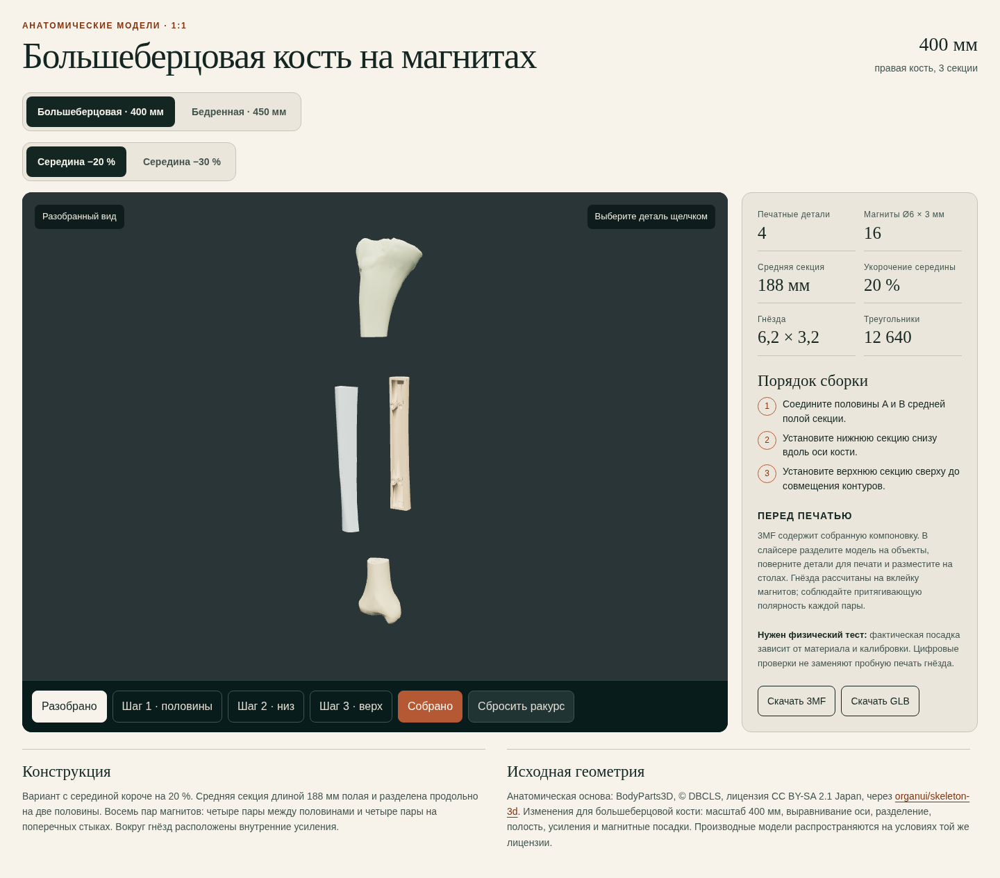

# Magnetic Bone Models

Разборные анатомические модели в натуральную величину: правая большеберцовая кость, бедренная кость и череп с нижней челюстью. Каждая модель состоит из трёх секций и четырёх печатных деталей. Соединения выполнены на магнитах Ø6 × 3 мм.



## Возможности

- Большеберцовая кость длиной 400 мм и бедренная кость длиной 450 мм.
- Череп высотой 220 мм, включая нижнюю челюсть.
- У костей есть варианты со средней секцией короче на 20 % или 30 %; у черепа одна версия.
- Четыре отдельные детали и 16 магнитов на каждую модель.
- Скрытые посадки Ø6,2 × 3,2 мм с внутренними усилениями.
- Цветные GLB для просмотра и монохромные 3MF для печати.
- Интерактивный сайт с выбором модели, пошаговой сборкой и разобранным видом.
- Исходники Blender и Python, отдельные детали и отчёты проверок.

## Готовые модели

| Модель | Общий размер | Средняя секция | Магниты | Файлы |
|---|---:|---:|---:|---|
| Большеберцовая, середина −20 % | 400 мм | 188 мм | 16 | [GLB](app/assets/tibia_magnetic.glb) · [3MF](app/assets/tibia_magnetic.3mf) |
| Большеберцовая, середина −30 % | 400 мм | 164,5 мм | 16 | [GLB](app/assets/tibia_magnetic_30.glb) · [3MF](app/assets/tibia_magnetic_30.3mf) |
| Бедренная, середина −20 % | 450 мм | 212 мм | 16 | [GLB](app/assets/femur_magnetic.glb) · [3MF](app/assets/femur_magnetic.3mf) |
| Бедренная, середина −30 % | 450 мм | 185,5 мм | 16 | [GLB](app/assets/femur_magnetic_30.glb) · [3MF](app/assets/femur_magnetic_30.3mf) |
| Череп с нижней челюстью | 220 мм | 50 мм | 16 | [GLB](app/assets/skull_magnetic.glb) · [3MF](app/assets/skull_magnetic.3mf) |

GLB сохраняет цвета и предназначен для 3D-просмотра. 3MF представляет собой белую монохромную модель. Оба формата содержат полную сборку в собранном положении, без раскладки деталей на печатном столе.

## Печать и сборка

1. Откройте нужный 3MF в слайсере и разделите сборку на отдельные объекты.
2. Разместите четыре детали на печатных столах и выберите ориентацию с учётом своего принтера и материала.
3. Перед печатью полной модели рекомендуется проверить посадку на пробном фрагменте с гнездом.
4. Вклейте магниты Ø6 × 3 мм в посадки, соблюдая притягивающую полярность на каждом стыке.
5. Соедините половины средней секции, затем установите её между концевыми секциями.

Цифровые проверки подтверждают замкнутость деталей, размеры и расположение посадок, отсутствие пересечений в сборке и прохождение прямолинейных сборочных траекторий. Слайсер, G-code, физическая печать и испытание магнитов не выполнялись; фактическая посадка зависит от материала и калибровки принтера.

## Интерактивный просмотр

Сайт находится в папке `app`. Для локального запуска:

```bash
cd app
python3 -m http.server 8000
```

После этого откройте `http://localhost:8000`. На странице можно выбрать модель, вращать её, выделять детали, переключать собранный и разобранный виды и проходить шаги сборки. Для костей доступны версии −20 % и −30 %; при выборе черепа этот переключатель скрывается.

## Структура репозитория

```text
app/                  Сайт и готовые GLB/3MF с именами на английском
tibia_magnetic/       Большеберцовая кость, середина −20 %
tibia_magnetic_30/    Большеберцовая кость, середина −30 %
femur_magnetic/       Бедренная кость, середина −20 %
femur_magnetic_30/    Бедренная кость, середина −30 %
skull_magnetic/       Череп с нижней челюстью
```

Внутри модельных папок находятся исходники, отдельные печатные детали, рендеры и JSON-отчёты проверок.

## Анатомическая основа

Анатомические исходники: BodyParts3D © DBCLS, лицензия CC BY-SA 2.1 Japan, получены через проект [organui/skeleton-3d](https://github.com/organui/skeleton-3d). Поверх исходной геометрии выполнены разделение на секции, магнитные соединения, посадки и внутренние усиления. В черепе сохранены естественные внутренние полости.

Проект предназначен для демонстрационных и учебных макетов, а не для медицинского применения.
